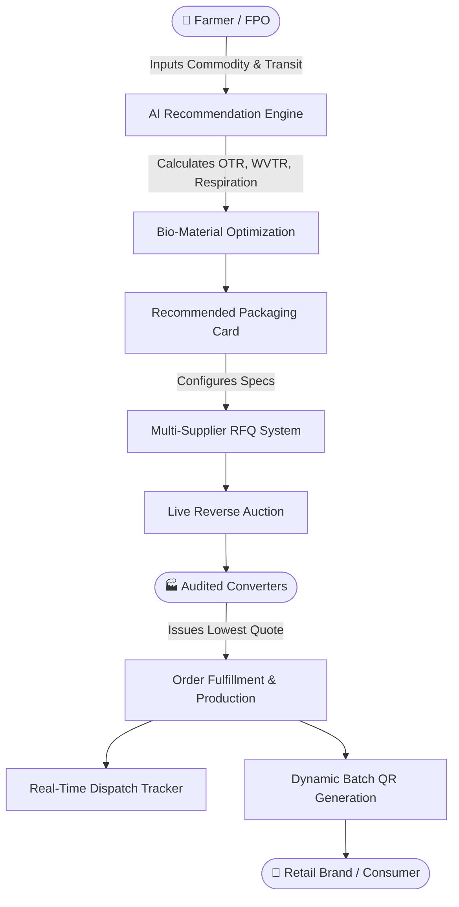

<div align="center">

# 🌿 Packit Up
### *Smart Packaging for a Fresher Tomorrow*

[](https://vitejs.dev/)
[](https://reactjs.org/)
[](https://www.typescriptlang.org/)
[](https://tailwindcss.com/)
[](LICENSE)

**An AI-driven agri-food packaging ecosystem engineered to eliminate post-harvest crop loss, connect Indian farmers with audited bio-converters, and deliver farm-to-fork batch traceability.**

[Explore Features](#-key-features) · [System Architecture](#-system-architecture) · [Getting Started](#-getting-started) · [Tech Stack](#-tech-stack)

</div>

---

## 📌 Executive Summary & Problem Statement

In India, **over 30% to 40% of fresh fruits and vegetables perish** before reaching end consumers. Smallholder farmers and Farmer Producer Organisations (FPOs) face severe structural bottlenecks:
1. **Substandard Packaging**: Produce is transported in non-ventilated wooden boxes, generic gunny sacks, or uncalibrated polybags lacking essential oxygen transmission (OTR) and moisture vapor barriers (WVTR).
2. **High Minimum Order Quantities (MOQs)**: Industrial converters cater primarily to enterprise brands, locking out farmers needing batches under ₹50,000.
3. **Broken Traceability**: Lack of batch-level transparency results in rejected export consignments, lack of consumer trust, and inability to track temperature abuse during road transit.

**Packit Up** bridges this gap by democratizing food-science packaging recommendations, fair-market reverse auction bidding, and tamper-evident QR verification.

---

## ⚡ Key Features

### 1. 🔬 AI Food-Science Recommendation Engine
- Analyzes crop respiration rates ($mg\ CO_2 / kg \cdot hr$), ethylene production, moisture sensitivity, and transit climate.
- Formulates multi-tiered recommendations across **Cost Plan**, **Shelf-Life Plan**, and **Smart AI-Auction Plan**.
- Recommends sustainable, bio-circular materials: **PLA + PBAT Films**, **Moulded Bagasse Pulp**, **Micro-perforated Bio-polymers**, and **Kraft Barrier Laminates**.

### 2. 🏭 Audited Converter Marketplace & Live Bidding
- Direct factory connection between farmers/FPOs and verified packaging converters.
- **Reverse Auction Engine**: Converters compete on multi-parameter RFQs (lead time, unit cost, lab certifications), driving down procurement costs and offering low MOQs starting from ₹15,000.

### 3. 📱 Dynamic Batch QR Traceability
- Generates batch-specific QR codes encoding harvest timestamp, farm origin, packaging specs, and cold-chain compliance (TDS, SDS, compostability certifications).
- Scan telemetry allows buyers and consumers to verify authenticity and freshness instantly.

### 4. 👥 Tailored Multi-Stakeholder Workflows
- **Farmer / FPO**: Simple visual commodity selector, instant barrier recommendations, and RFQ tracking.
- **Packaging Converter**: Live auction feeds, technical spec bidding, and capacity management.
- **Material Producer**: Bio-polymer catalog showcases, resin demand heatmaps, and direct inquiries.
- **Packhouse / Brand**: Cold-chain compliance auditing, shelf-life analytics, and export batch grading.
- **Transporter**: Reefer compatibility checks and real-time transit handoff validation.

### 5. 🎛️ Isolated Judge & Demo Simulation Controller (`/control`)
- A dedicated administrative suite allowing judges and developers to instantly simulate role transitions, trigger dynamic order states, and toggle AI optimization tiers.

---

## 📐 System Architecture



---

## 🛠 Tech Stack

- **Core Framework**: [React 18](https://reactjs.org/) + [TypeScript](https://www.typescriptlang.org/)
- **Build Tool**: [Vite 6](https://vitejs.dev/)
- **Styling**: [Tailwind CSS v4](https://tailwindcss.com/)
- **Icons**: [Lucide React](https://lucide.dev/)
- **Routing**: [React Router DOM v6](https://reactrouter.com/)
- **Visuals & Charts**: Custom Responsive SVG Sparklines & Ring Telemetry
- **Micro-Animations**: Canvas Confetti & CSS Transitions

---

## 🚀 Getting Started

### Prerequisites
- Node.js (v18.0.0 or higher)
- npm or yarn

### Installation

1. **Clone the repository:**
   ```bash
   git clone https://github.com/Krishna171205/Packitup.git
   cd Packitup
   ```

2. **Install dependencies:**
   ```bash
   npm install
   ```

3. **Start the local development server:**
   ```bash
   npm run dev
   ```
   Open [http://localhost:3000](http://localhost:3000) to view the application in the browser.

4. **Build for production:**
   ```bash
   npm run build
   ```

5. **Type check:**
   ```bash
   npx tsc --noEmit
   ```

---

## 📂 Project Structure

```text
FOOD SIH/
├── public/               # Static assets & icons
├── src/
│   ├── components/       # Reusable UI (AppLayout, BottomNav, SimulationControls)
│   ├── context/          # AppContext (Role state, simulation, language)
│   ├── data/             # Commodity datasets, suppliers, materials mock database
│   ├── screens/          # Core views
│   │   ├── Splash.tsx
│   │   ├── Onboarding.tsx
│   │   ├── RoleSelection.tsx
│   │   ├── Home.tsx
│   │   ├── CreateProjectWizard.tsx
│   │   ├── PackagingBlueprintScreen.tsx
│   │   ├── SuppliersListScreen.tsx
│   │   ├── SupplierDetailScreen.tsx
│   │   ├── RequestQuoteScreen.tsx
│   │   ├── OrderTrackingScreen.tsx
│   │   ├── QRTraceabilityScreen.tsx
│   │   ├── AnalyticsDashboardScreen.tsx
│   │   └── ControlPanel.tsx
│   ├── styles/           # Tailwind CSS v4 design tokens
│   ├── routes.tsx        # Central router configuration
│   └── main.tsx          # Application entrypoint
├── package.json
├── vite.config.ts
└── tsconfig.json
```

---

## 📄 License
This project is licensed under the [MIT License](LICENSE).
